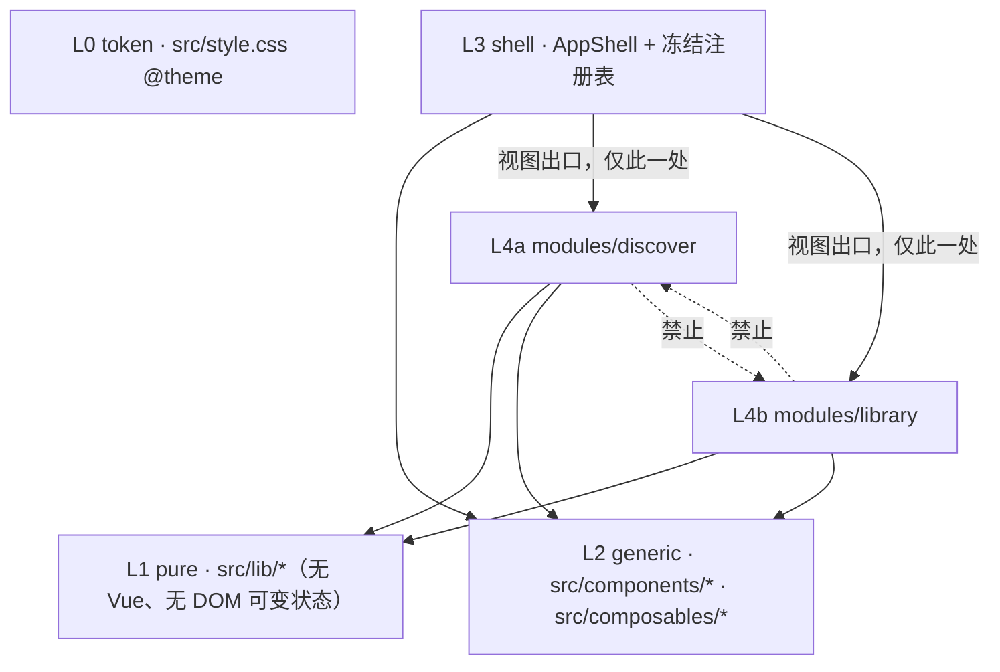

# 架构：统一之下的模块自治

本文回答一个问题：**哪些东西必须全局只有一个，哪些东西每个模块必须自己有一份，以及靠什么机制保证。**
设计 token 见 [design-tokens.md](design-tokens.md)，工程流程见 [development.md](development.md)。

## 1. 判据

共享与否不看「能不能复用」，只看**变化轴是否相同**：

- 变化轴相同（设计语言、窗口层级、URL 协议、数据访问契约）→ 必须全局唯一，模块无权自造
- 变化轴不同（数据模型、检索语义、状态结构、存储键）→ 必须模块私有，公共层无权收编

反例纪律：两模块「模式相似」不是抽象理由（Rule of Three，复用点不足 3 处就各自实现）。

## 2. 分层与依赖方向

| 从 ↓ 可依赖 →         | L0  | L1  | L2  | L3  | 其他模块      |
| --------------------- | --- | --- | --- | --- | ------------- |
| `lib/`                | ✅  | ✅  | ❌  | ❌  | ❌            |
| `components/`         | ✅  | ✅  | ✅  | ❌  | ❌            |
| `composables/`        | ✅  | ✅  | ✅  | ❌  | ❌            |
| `modules/<self>/`     | ✅  | ✅  | ✅  | ❌  | ❌            |
| `components/AppShell` | ✅  | ✅  | ✅  | —   | ✅ 仅视图出口 |

`lib/` 不得 import `vue`：纯函数才能脱离组件树单测（现有 `filter/hash/highlight/reorder` 均如此）。

## 3. 命名空间登记表（冻结，append-only）

| 命名空间     | 归属            | 现行值                                                                                | 规则                                                       |
| ------------ | --------------- | ------------------------------------------------------------------------------------- | ---------------------------------------------------------- |
| localStorage | 每模块一后缀    | `ash-hub_favs` `ash-hub_recent` `ash-hub_custom_order` / `ash-hub_assets_favs`        | 前缀 = 项目名；两域零交叉；键名字面量只在 `lib/storage.ts` |
| hash 参数    | 应用级 / 每模块 | `view` / `q` `fav` `types` `licenses` `registers` / `asset` `ver`                     | 只增不改；单一写者 `patchHash`                             |
| 全局快捷键   | 应用级          | `/` `R` `G` `L` `S` `?` `Esc` `Ctrl/Cmd+K`                                            | 冻结；模块内键须限定作用域                                 |
| z-index      | 应用级          | 背景 0 · 卡片悬浮 10 · 浮层 10000 · 预览 15000 · 右键 20000 · HUD 30000 · toast 40000 | 新浮层必须在表中取层，禁止随手写                           |
| 设计 token   | 应用级          | `src/style.css` `@theme` 内的 `--color-cyber-*` 等                                    | 组件禁引入新色值                                           |

hash 只能有一个写者：所有写方走 `src/lib/hash.ts` 的 `patchHash`（增量保留，不全量重建）。多个写者各用各的序列化，必然互相抹掉对方的键。

## 4. 模块自治：模块内必须自己拥有的东西

| 内容     | 发现域                           | 资产域                              |
| -------- | -------------------------------- | ----------------------------------- |
| 数据模型 | `types.ts`：`Site`               | `modules/library/types.ts`：`Asset` |
| 状态     | `useSiteCatalog` / `useRecent`   | `useAssetLibrary`                   |
| 存储键   | `ash-hub_*`                      | `ash-hub_assets_*`                  |
| 视图树   | `modules/discover/SitesView.vue` | `modules/library/LibraryView.vue`   |
| 检索语义 | 空格 AND + 评分排序 + 高亮       | 名称/prompt/标签 子串 AND，无排序   |
| 数据访问 | 静态 `data/sites.ts`             | `AssetRepository` 接口              |

检索语义相似但**不共享实现**：发现的评分排序与资产的子串匹配是两条独立规则，合成一个「通用搜索」会把两边的演进绑死。

## 5. 共享层准入

| 位置           | 准入条件                                                                                |
| -------------- | --------------------------------------------------------------------------------------- |
| `lib/`         | 纯逻辑 + 可单测；≥2 处复用或有独立测试价值                                              |
| `components/`  | ≥2 模块使用，且不含领域数据结构（只吃 primitive / slot）                                |
| `composables/` | 跨模块或壳层使用（模块专属 state 归模块目录）                                           |
| token          | 只在 `style.css @theme`；透明度变体允许 `rgb(0 240 255 / x)` 复用既有色，不得引入新色值 |

## 6. 扩展点契约（新增模块或功能时必须登记）

1. **视图出口**：`AppShell` 一行分支 + 切换按钮 + `view` 参数值（三处同改，缺一即算未接入）
2. **数据访问**：模块外的数据入口是 Repository 接口，视图不直读 mock 常量
3. **URL**：新增 hash 参数先登记 §3 表格，再实现
4. **命令**：能力并入 `Ctrl/Cmd+K` 命令面板注册项，不建第二套命令系统
5. **提示**：`toast()` 全局唯一，模块不自定义通知层
6. **按键**：全局表冻结；模块内快捷键必须写明作用域（如「仅预览浮层内」）

## 7. 强制手段（可执行，非口头约定）

边界靠 ESLint `no-restricted-imports` 守住，零新增依赖（见 `eslint.config.js`）：

- 模块间互引 → error
- `lib/` 引 `vue` → error
- `components/` 引 `modules/` → error

违反即 `pnpm lint` 失败，评审前就暴露。文档负责解释原因，规则负责阻止违反。

## 8. 变更流程

- 新增共享项：先指出 ≥2 处现有复用点，否则写在模块内
- 新增模块：登记 §3 表格三行（hash 值、存储前缀、z-index 层）+ §2 依赖矩阵
- 冻结项变更：append-only 语义，改既有键需在 PR 说明理由并同步 AGENTS §2

## 9. 已登记的欠账（记录，不在 P2 之前处理）

- `composables/` 平铺：`useHotkeys` `useSiteCatalog` `useDragSort` `useRecent` 实际属发现域，暂标为私有，物理搬迁随 P3 重组
- `AppToast` 挂在 `SitesView` 内部 → **资产域没有 toast 层**；P2 预览器要提示错误态前必须先提到 `AppShell`（§6「toast 全局唯一」）
- 提到 `AppShell` 时连带修 z-index：`AppToast` 与 `CommandPalette` 同为 `z-[10000]`，当前靠 DOM 顺序（toast 在后）偶然压住面板，顺序一变就被全屏遮罩吞掉；按 §3 应为 40000
- `useHashSync` 全量重建 hash，抹掉 `view`：P2 前置修复（见 p2 规格）
- 旧 `ah_*` 键迁移代码（`lib/storage.ts`）是兼容层，待下个大版本确认无老数据后移除
